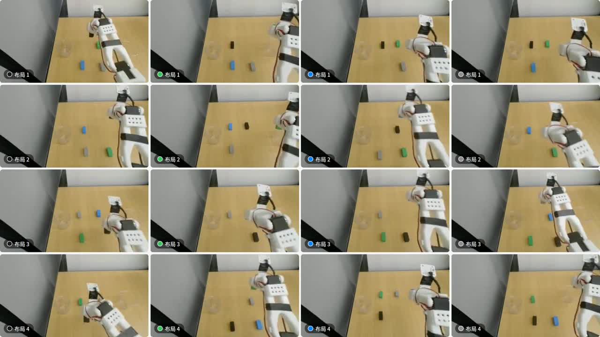

# Robot ICL from Human Demonstrations

**项目参与者：许雅雯**　|　**真机平台：SO-101**

当语言指令保持不变，机器人能否根据一段人手示范选中目标并执行操作？这个项目复现并比较三种示范接入方式，将其中的 Zero-WAM 迁移到 SO-101，完成了数据配对、后训练、远端推理、真机执行和失败分析。

[观看 SO-101 演示视频](so101-demo.mp4) · [实验设置与结果](experiments.md) · [实现与复现索引](implementation.md) · [结构化证据索引](manifest.json)

## 三条复现路线

三种方法分别在采样起点、动作头记忆和视频上下文中使用示范。它们是独立的比较路线。

| 路线 | 示范如何进入策略 | 本项目完成的工作 | 结果与边界 |
| --- | --- | --- | --- |
| DemoDiffusion | 将参考动作加噪到 `τ`，作为 Flow Matching 采样起点 | 接通 SmolVLA / SO-101 与 π0.5 / LIBERO-90，开展噪声强度和参考动作对照 | 所测 checkpoint 的可用 `τ` 约为 `0.1–0.2`。在一组 recorded-reference 仿真对照中，纯回放为 90%，各非零噪声融合档不超过 17.5% |
| RoboTTT | 用示范前缀更新 DiT Action Head 中的 Fast Weights | 适配 GR00T 骨干，采用 FP32 内层更新和 BF16 主干，完成 Stage-1，并诊断 Stage-2 的示范读出 | 诊断中，末态 Fast Weights 的 1-NN 示范识别准确率为 1.000，示范分量占状态范数的 0.039%。Stage-2 的有效动作读出尚待验证 |
| Zero-WAM | 将人手视频编码为 Context Tokens，与机器人观测共同进入视频和动作模型 | 构建 240 对人机配对数据，采用 Token Packing 后训练 6000 steps，通过 WebSocket 接通 SO-101 | 真机跟随训练后新录的灰块示范。未见红色目标测试成功 2/4，仍需用位置与颜色解耦的对照区分两类线索 |

## 我的工作

- **模型复现与训练。** 协作复现三条路线，适配 Flow Matching 参考动作采样和 TTT 记忆层，开展 `τ` 消融、混合精度训练及 Prefix 诊断。
- **配对数据与后训练。** 设计 SO-101 的 6 个任务与 4 种布局，构建 240 对机器人轨迹和人手示范，其中 80 条为真人示范、160 条由 MiniMax-H3 生成。用 Token Packing 完成 Zero-WAM 后训练。
- **真机部署与评测。** 通过 WebSocket 连接远端推理服务和 SO-101，核对关节增量的单位、通道和时序。使用训练后新录示范、未见颜色、视频平移和示范与场景布局不一致的测试，分析模型实际跟随的线索。

## 仓库状态

当前整理包含项目说明、实验记录摘要和 SO-101 演示。`robottt.zip`、`smolvla-robottt.zip` 和 `Zero-WAM.zip` 的实现、配置与运行入口待核对后归档。各指标的证据类型和结论边界见[实验记录](experiments.md)。

## 上游研究

- [DemoDiffusion](https://arxiv.org/abs/2506.20668)
- [RoboTTT](https://research.nvidia.com/labs/gear/robottt)
- [Zero-WAM](https://arxiv.org/abs/2608.26103)

论文方法与上游实现归原作者。本项目记录复现、适配、训练和评估工作。
